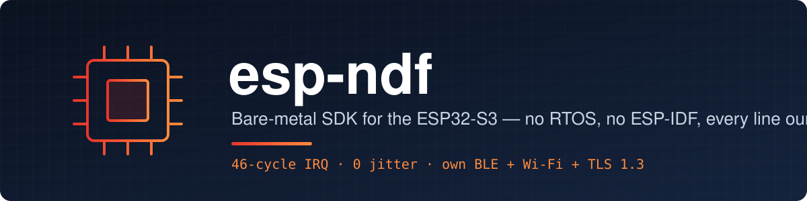

<p align="center">
  
</p>

<p align="center">
  
  
  
  
  
</p>

<p align="center">
  <b>STM32-class determinism on both cores of the ESP32-S3.</b><br>
  No RTOS, no ESP-IDF, no ROM calls, no libgcc — drivers, wireless stacks and crypto are all our own code,<br>
  and every feature is measured against its ESP-IDF twin on the same board.
</p>

<p align="center">
  <a href="#measured-on-hardware">Performance</a> ·
  <a href="#wireless">Wireless</a> ·
  <a href="#design">Design</a> ·
  <a href="#repository-layout">Layout</a> ·
  <a href="#getting-started">Getting started</a> ·
  <a href="#documentation">Docs</a>
</p>

---

## Measured on hardware

ESP32-S3 at 240 MHz. Full data and methods: [docs/PERFORMANCE.md](docs/PERFORMANCE.md).

**Interrupt latency** — timer match → first instruction of the C handler
(`components/arch/test_apps/irq_latency`, 20 000 samples per level):

| Level | esp-ndf | ESP-IDF 5.3 |
|---|---|---|
| 1 | **76 cycles, 0 jitter** | 219–405 cycles |
| 3 | **63 cycles, 0 jitter** | 214–274 cycles |
| 5 (fast path) | **46 cycles (191 ns), 0 jitter** | assembly handlers only |

**20 kHz control loop** on both cores + 10 kHz timer ISR + USB telemetry
(`examples/system/bench`; the same `bench/bench.h` built for ESP-IDF and esp-hal):

| | esp-ndf | FreeRTOS (IDF) | esp-hal 1.2 |
|---|---|---|---|
| core1 loop worst case | **0.96 µs** | 10.1 µs | 1.43 µs |
| timer ISR period jitter | **16 ns** | 62 ns | 15 µs (73 ISRs lost) |
| missed 50 µs deadlines | 0 | 1 | 0 |

## Wireless

Own BLE link layer and host, own Wi-Fi MAC driver, lwIP, HTTP, WebSocket, MQTT, TLS 1.2/1.3 — optional components
(`COMPONENTS = ble_host wifi lwip net tls`), each tested against ESP-IDF running on a second board.

| Area | What works |
|---|---|
| **BLE** | GATT server + client, central and peripheral, two simultaneous links, LE Secure Connections pairing, link encryption, bonding in NVS, privacy (RPA) |
| **Wi-Fi** | Station (open, WPA2, WPA3-SAE, PMF) and access point (open, WPA2-PSK), hardware ACK, hardware CCMP receive |
| **IP** | DHCP client/server, DNS, SNTP, TCP/UDP, HTTP client/server, WebSocket, MQTT 3.1.1 |
| **TLS** | 1.3 and 1.2, client and server, X25519 / P-256, AES-128-GCM — interoperates with OpenSSL and mbedtls |

Same chip, same air:

| | esp-ndf | ESP-IDF |
|---|---|---|
| BLE 244-byte notifications | **726–739 kbit/s** | 719 kbit/s (NimBLE) |
| BLE 4-byte notifications | **~1050 /s** | 735 /s |
| ECDSA P-256 verify / sign | **54 / 27 ms** | 291 / 148 ms (mbedtls) |
| X25519 shared secret | **46 ms** | 117 ms |
| AES-128-GCM, 1 MB | **169 ms** | 447 ms |
| softAP beacon jitter (std dev) | **313–486 µs** | 512–1103 µs |

Status and open items: [docs/WIRELESS.md](docs/WIRELESS.md) · MAC bring-up: [docs/WIFI_MAC.md](docs/WIFI_MAC.md).

## Design

- **Interrupt and control code always in RAM** — vectors, handlers, the scheduler and everything an interrupt
  or a flash operation can reach live in SRAM. Bulk library code runs from flash through the 32 KB instruction cache
  (`XIP=lib`, default); `XIP=off` keeps the whole image in RAM, `XIP=all` also moves the application.
- **CALL0 ABI** (no register windows) — interrupt entry saves 16 words, never spills windows, and window
  exceptions can't add jitter.
- **Own vectors and dispatcher** — levels 1–3 dispatch in assembly; levels 4–5 have one direct fast handler each.
  Level 1 drops to INTLEVEL 1 so 2–5 nest over it (NVIC-style). The FPU is off inside handlers: float use in an ISR
  faults loudly instead of corrupting state.
- **Loud faults** — cause, PC and address on the console; core dumps decode with `tools/coredump.py`.
- **Security-tested** — every parser (FAT, NVS, SPIFFS, ATT, SMP, Wi-Fi frames, EAPOL, SAE, TLS, MQTT, WebSocket)
  is fuzzed under ASan + UBSan by `tools/security_test.sh`. See [SECURITY.md](SECURITY.md).

## Repository layout

```
components/
  arch/xtensa/    start.S (both cores), vectors.S, irq.c
  soc/esp32s3/    register map, clocks/WDT/core1, linker script, loader
  drivers/<x>/    one folder per peripheral (gpio, spi, uart, usb, storage, crypto, rf, ble, ...)
  ble_host/       ATT / GATT / L2CAP / SMP
  wifi/ lwip/     Wi-Fi station + AP, WPA2/WPA3, lwIP port
  net/ tls/       HTTP, DNS, SNTP, WebSocket, MQTT, TLS 1.2/1.3
  lib/            printf, libm, heap, dsp, nn, ecc, ...
  include/        public API: ndf.h irq.h sys.h console.h ...
  <c>/test_apps/  that component's tests, one application each
make/             project.mk (build rules), boards.mk, unit_main.c
examples/         by area: system/ storage/ usb/ bluetooth/ rf/ rf_lab/ box3/
tests/            cross-component tests: stress, soak, runtime
bench/            ESP-IDF / esp-hal twins and the data behind docs/PERFORMANCE.md
tools/            host scripts: ndf_test.py, flashing, fuzzers, signing; rf/ and wl/ for RF and wireless tests
docs/             API, configuration, performance, security
```

Porting to another chip = a new `components/soc/<chip>/` (and `components/arch/riscv/` for RISC-V) — see
[docs/PORTING.md](docs/PORTING.md).

## Getting started

Needs the Espressif `xtensa-esp32s3-elf` GCC (from the ESP-IDF tools) and `esptool.py`. An application is a folder
with a three-line Makefile:

```sh
cd examples/system/bench && make flash monitor        # build, flash, open the console
cd components/arch/test_apps/irq_latency && make flash
make test BOARD=devkit                                # every unit test on the board
make menuconfig                                       # per-app configuration (docs/CONFIG.md)
```

New application: copy any example folder, set `NDF_PATH` to the esp-ndf root and add your sources.

> `make flash` writes to flash 0x0 (the bootloader slot). Flashing any ESP-IDF project restores the normal bootloader.

## Documentation

| | |
|---|---|
| [API.md](docs/API.md) | Public API reference |
| [CONFIG.md](docs/CONFIG.md) | Every configuration option |
| [PERFORMANCE.md](docs/PERFORMANCE.md) | All measurements vs ESP-IDF / ESP-DSP |
| [TESTING.md](docs/TESTING.md) | Test apps, boards, `make test` |
| [WIRELESS.md](docs/WIRELESS.md) | BLE / Wi-Fi / IP status |
| [DEBUG.md](docs/DEBUG.md) | JTAG, core dumps, tracing |
| [examples/README.md](examples/README.md) | Every example |

## License

BSD 3-Clause — see [LICENSE](LICENSE).
